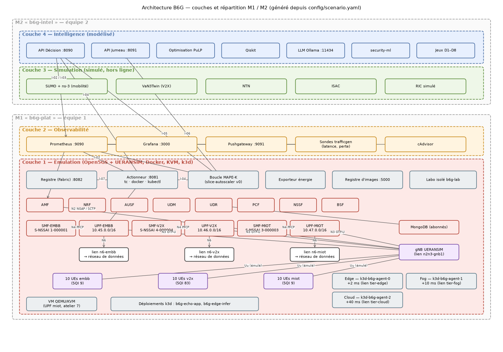

# Atelier 2 — Architecture et composants d'un réseau B6G

| Rubrique | Contenu |
| --- | --- |
| Objectif | Décrire les domaines du réseau B6G (accès, cœur, Edge / Fog / Cloud, intelligence), leurs composants et les flux qui les relient. |
| Étiquette de réalisme | **DOCUMENTAIRE** (architecture) ; les composants de la couche 1 et 2 sont **ÉMULÉS** et en fonctionnement |
| Ce qui est réel | Composants déjà déployés sur M1 : 11 fonctions Open5GS, gNB et 30 UEs UERANSIM, Prometheus, Grafana, Actionneur, registre d'images |
| Ce qui est simulé et pourquoi | RIC, ISAC, NTN, mobilité : couche de simulation de l'équipe 2 (résultats hors ligne) ; pas de couche radio réelle |
| Interfaces utilisées | I-01 à I-12 (table des flux) |
| Comment lancer | `.venv/bin/python docs/architecture/make_architecture.py` (régénère le schéma depuis le scénario) |
| Résultat attendu | Architecture B6G annotée et table des flux entre composants |
| Résultat obtenu (source, date) | [docs/architecture/b6g-architecture.png](../../docs/architecture/b6g-architecture.png), [flows.md](../../docs/architecture/flows.md), 2026-11-21 |

## Étapes

| Étape | Tâche | Contenu | Livrable | État |
| --- | --- | --- | --- | --- |
| E01–E04 | T02.1 | Domaines réseau, fonctions d'accès (gNB UERANSIM, RIC simulé), cœur (NF Open5GS, une SMF et une UPF par slice), Edge / Fog / Cloud | [b6g-architecture.drawio](../../docs/architecture/b6g-architecture.drawio) + [.png](../../docs/architecture/b6g-architecture.png) | fait |
| E05–E06 | T02.2 | Fonctions IA (décision, prévision, détection) et de sécurité | calques IA et sécurité du schéma | équipe 2 |
| E07–E08 | T02.3 | Jumeau numérique et fonctions de détection (ISAC) | calque jumeau et ISAC du schéma | équipe 2 |
| E09–E10 | T02.4 | Assemblage de l'architecture annotée et table des flux | [docs/architecture/flows.md](../../docs/architecture/flows.md) | fait |

## Architecture en couches

| Couche | Machine | Composants | Réalisme |
| --- | --- | --- | --- |
| 4 — Intelligence | M2 `b6g-intel` | API Décision, API Jumeau, PuLP, Qiskit, LLM, security-ml, jeux D1–D8 | modélisé |
| 3 — Simulation | M2 | SUMO + ns-3, VaN3Twin (V2X), NTN, ISAC, RIC | simulé |
| 2 — Observabilité | M1 `b6g-plat` | Prometheus, Grafana, Pushgateway, cAdvisor, sondes | réel |
| 1 — Émulation | M1 | Open5GS (11 NF dont 3 SMF et 3 UPF), UERANSIM (gNB, 30 UEs), Actionneur, registre, boucle, VM, k3d | émulé |

Les mesures montent (couches 1 → 2 → 4), les décisions redescendent (couche 4 → Actionneur → couche 1).

## Contrôle de complétude (critère T02.1)

Le schéma est généré depuis `config/scenario.yaml` : chaque fonction réseau (`nfs`), chaque slice (SMF, UPF,
sous-réseau, S-NSSAI, 5QI), chaque niveau (`tiers`, nœud k3d, délai ajouté), chaque lien (`links`) et chaque
déploiement (`deployments`) y figure. 50 blocs, 28 flux annotés.

## Critère T02.4

Chaque flux entre modules de la table correspond à une interface I-01 à I-12 (13 flux, section 1 de `flows.md`) ;
les flux internes au cœur 5G (N1, N2, N3, N4, N6, SBI) sont décrits séparément et observés à l'atelier 3.
