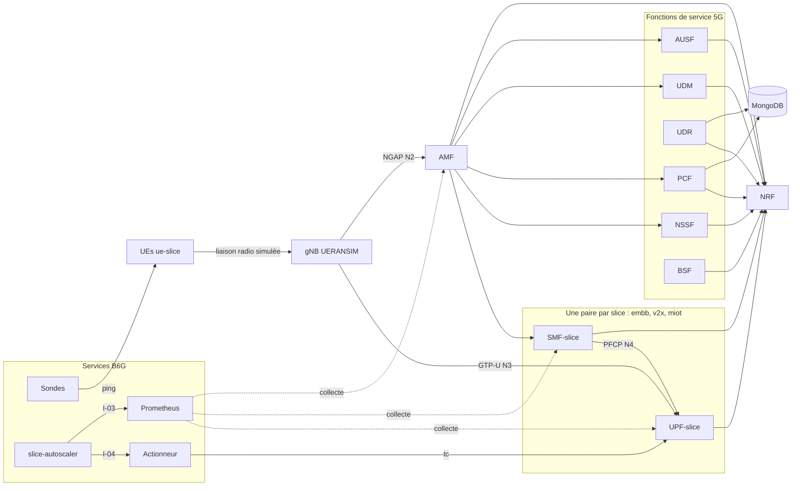

# Microservices de la plateforme et dépendances (T08.1)

Atelier 8, étapes E01 à E03. La plateforme est un ensemble de microservices : chaque fonction réseau Open5GS, chaque
composant RAN UERANSIM et chaque service B6G tourne dans son propre conteneur, joint par le réseau et non par des
appels internes. Les dépendances de démarrage du cœur sont celles déclarées (`depends_on`) dans le fichier Compose
généré par `platform/core/render.py` ; `make up-core` les applique dans l'ordre ci-dessous.

## Graphe de dépendances

## Ordre de démarrage (`make up-core`)

| Ordre | Services | Condition de passage | Raison |
| --- | --- | --- | --- |
| 1 | `mongo` | réponse à `ping` (mongosh) | Base des abonnés et des politiques (UDR, PCF) |
| 2 | chargement des 30 abonnés | script `subscribers.js` | Les UEs doivent exister avant leur enregistrement |
| 3 | `nrf` | conteneur démarré | Annuaire : toutes les autres fonctions s'y enregistrent (SBI) |
| 4 | `ausf`, `udm`, `udr`, `pcf`, `nssf`, `bsf` | conteneurs démarrés | Services d'authentification, de profil, de politique et de sélection de slice |
| 5 | `upf-<slice>` puis `smf-<slice>` | conteneurs démarrés | La SMF établit l'association PFCP avec son UPF au démarrage |
| 6 | `amf` | puis 5 s d'attente | L'AMF découvre AUSF, UDM, PCF, NSSF et les SMF par le NRF |
| 7 | `gnb` | puis 3 s d'attente | Association NGAP (SCTP) avec l'AMF |
| 8 | `ue-embb`, `ue-v2x`, `ue-miot` | 10 interfaces `uesimtun` par conteneur | Enregistrement puis session PDU de chaque UE |
| 9 | `make up-obs`, `make up-actuator`, `make up-probes` | réseau `b6g-core` présent | Les services B6G observent et pilotent le cœur |

## Effet d'un ordre non respecté (observé)

| Situation | Effet observé | Rattrapage |
| --- | --- | --- |
| UPF indisponibles au démarrage de l'atelier INT1 | 48 échecs d'enregistrement (cause 90) côté AMF, nouvelles tentatives des UEs | Automatique dès que les UPF répondent (minuterie NAS T3511) |
| Abonnés absents de MongoDB | Rejet de l'authentification | `make core-subscribers` puis redémarrage des UEs |
| Réseau `b6g-core` absent au lancement de `make up-obs` | Échec du démarrage de Prometheus (réseau externe inconnu) | `make up-core` d'abord |

## Dans Kubernetes (k3d)

Le même graphe s'applique au déploiement d'Open5GS dans le cluster (charts Helm Gradiant, `platform/k8s/values/`),
mais sans ordre explicite : toutes les fonctions démarrent ensemble et Kubernetes redémarre celles qui échouent
tant que leur dépendance n'est pas prête (observé : PCF et UDR redémarrés 7 fois en attendant MongoDB). Le seul
conteneur d'initialisation est celui de l'UPF (création de l'interface `ogstun`). Le gNB et les UEs doivent en
revanche être redémarrés dans l'ordre (gNB stable, puis UEs), sinon un UE peut s'attacher à un pod gNB en cours de
remplacement (voir `ateliers/a08/README.md`).
